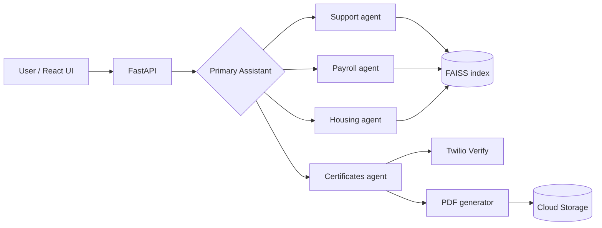

# Multi-Agent RAG Chatbot

A reference implementation of a multi-agent customer-service chatbot built with
**LangGraph**, **FastAPI**, **FAISS** and **React**. A router agent hands each
conversation to specialized domain agents. The agents answer from your own PDF
documents through retrieval-augmented generation (RAG), and they can run
authenticated actions such as generating PDF certificates after OTP
verification.

It started as a production prototype for a member-services cooperative in
Colombia. Client-specific data has been removed and replaced with sample
documents, so you can adapt it to your own domain.

## Features

- **Multi-agent routing with LangGraph.** A primary assistant classifies intent
  and routes the conversation to specialized agents (support, payroll, housing,
  certificates).
- **RAG over your PDFs.** Documents are chunked, embedded with Google embeddings
  and indexed in FAISS for semantic search.
- **Authenticated tool use.** Sensitive actions require SMS/WhatsApp OTP
  verification through Twilio Verify.
- **PDF generation.** Certificates are rendered to PDF and stored in Google
  Cloud Storage, with signed URLs that expire after 24 hours.
- **Production-ready deployment.** Each service has its own Dockerfile and a
  Cloud Run deployment guide.

## Architecture



## Quickstart

**Requirements:** Python 3.10+, Node.js 18+, and a
[Gemini API key](https://aistudio.google.com/apikey).

### Backend

```bash
cd backend
python -m venv venv
source venv/bin/activate          # Windows: .\venv\Scripts\Activate.ps1
pip install -r requirements.txt
cp .env.example .env              # then fill in your keys
uvicorn app.main:app --reload --port 8000
```

### Frontend

```bash
cd frontend-react
npm install
npm run dev                       # http://localhost:5173
```

The frontend points to `http://localhost:8000` by default. For production,
set `VITE_API_URL` in `.env.production`.

## Configuration

| Variable | Required | Purpose |
|---|---|---|
| `GOOGLE_API_KEY` | Yes | Gemini LLM and embeddings |
| `TWILIO_ACCOUNT_SID`, `TWILIO_AUTH_TOKEN`, `TWILIO_VERIFY_SERVICE_SID` | Certificates flow only | OTP verification |
| `GCP_PROJECT_ID`, `GCS_BUCKET_NAME` | Optional | Store generated PDFs in GCS |

<!-- TODO: check that the app starts with only GOOGLE_API_KEY set. If not, make Twilio/GCS optional in code. -->

## Adapting it to your domain

1. **Knowledge base:** replace the sample PDFs in `backend/docs/` with your
   own and rebuild the index (see `app/rag.py`).
2. **Agents:** agents and their system prompts are defined in `app/agent.py`.
   Add, remove or rename them to fit your use case.
3. **Tools:** agent tools live in `app/tools.py`. Each one is a plain Python
   function bound to an agent.

## Project structure

```
backend/
  app/
    main.py            # FastAPI entrypoint
    agent.py           # LangGraph graph and agents
    tools.py           # Agent tools
    rag.py             # FAISS indexing and retrieval
    otp.py             # Twilio Verify OTP
    pdf_generator.py   # PDF certificates
    gcs_storage.py     # Cloud Storage uploads and signed URLs
  docs/                # Sample knowledge-base PDFs
frontend-react/        # React + Vite chat UI
```

## Deployment

See [DEPLOY_CLOUD_RUN.md](./DEPLOY_CLOUD_RUN.md) for a step-by-step guide to
deploying both services to Google Cloud Run.

## Testing

```bash
cd backend && pytest
```

<!-- TODO: add at least tests for rag.py and for the router's intent classification -->

## Roadmap

- [ ] Pluggable vector store (FAISS / Chroma / pgvector)
- [ ] Pluggable object storage (GCS / S3-compatible)
- [ ] Config-driven agent definitions (YAML instead of code)
- [ ] Evaluation suite for retrieval quality

Contributions are welcome. See [CONTRIBUTING.md](./CONTRIBUTING.md).

## License

[MIT](./LICENSE)
